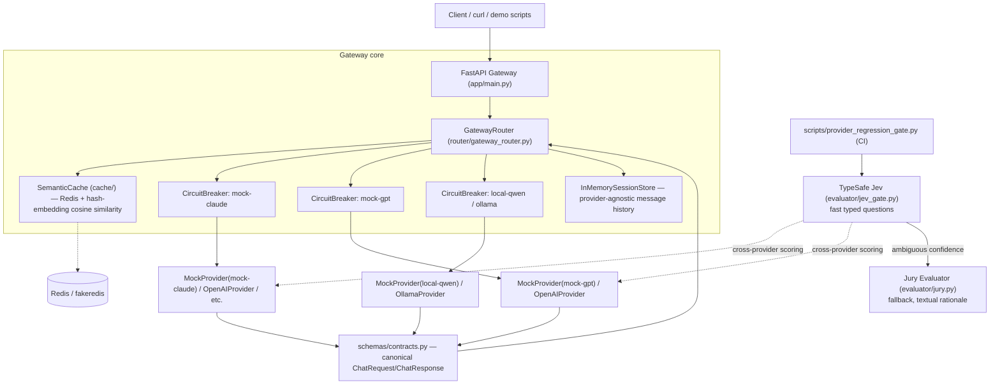
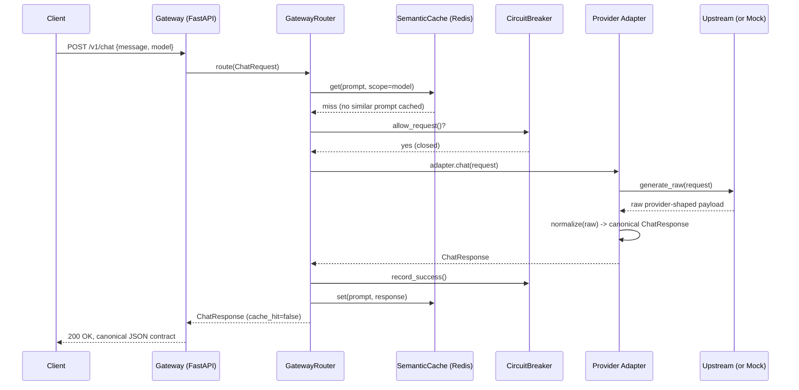
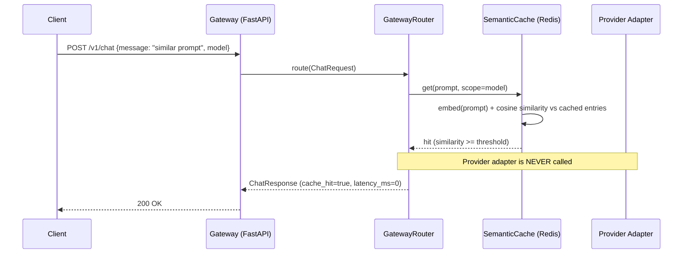
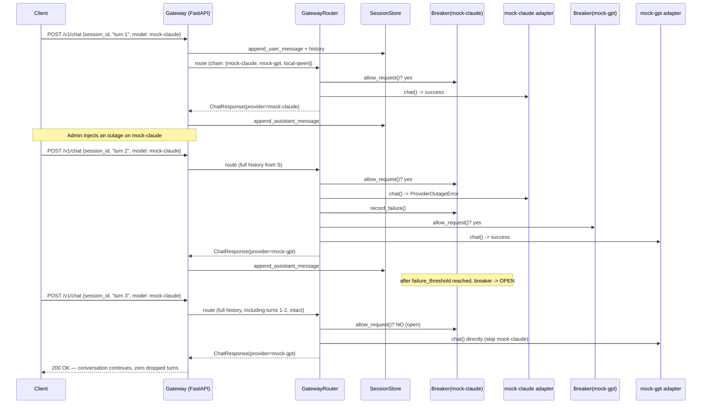
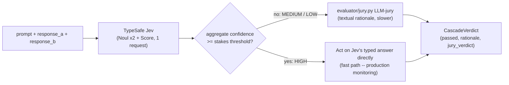

# Enterprise LLM Gateway Router

A **provider-agnostic LLM gateway** built around three ideas that matter once
you run more than one model provider in production:

1. **Schema contracts** -- every provider's response is validated/repaired
   into one canonical Pydantic contract, or rejected with a structured
   error. Callers never see provider-shaped payloads.
2. **Circuit breakers + failover** -- each provider gets its own
   closed/open/half-open circuit breaker. When a provider degrades (errors,
   429s), the router automatically fails over to the next provider in the
   chain -- **mid-conversation, with zero dropped context**.
3. **Semantic caching** -- a Redis-backed cache keyed by prompt embedding
   (cosine similarity, not exact string match) short-circuits repeat/near-
   duplicate calls before they ever reach a provider.

A fourth component, a **confidence-gated evaluator cascade** -- TypeSafe
[Jev](https://typesafe.ai/) (a real, typed "System One" model) for a fast
typed first pass, falling back to a small **LLM-jury** only when ambiguous
-- cross-checks that different providers answering the same prompt stay
semantically/contractually equivalent, and wires into an automated CI
regression gate.

The entire system -- gateway, three provider "personas", cache, breaker,
router, jury -- **runs fully offline with zero API keys**, via a deterministic
`MockProvider`. Real OpenAI / GCP Vertex AI / local Ollama adapters are
included and activate automatically when credentials/Ollama are present.

> Why build the adapter layer instead of just using `litellm`? For this
> self-contained demo we wanted full control over provider-specific raw
> payload shapes (to credibly demonstrate contract repair/rejection) and a
> minimal, auditable dependency footprint. See [Architecture](#architecture)
> for the full rationale. `litellm`-style unified routing is a perfectly
> valid alternative; this repo implements the same idea with a small,
> from-scratch adapter abstraction instead.

---

## Table of contents

- [Architecture](#architecture)
- [Sequence diagrams](#sequence-diagrams)
- [Quickstart](#quickstart)
- [Demo Script](#demo-script)
- [Evaluator](#evaluator)
- [Deployment](#deployment)
- [Testing](#testing)
- [Configuration reference](#configuration-reference)
- [Honest limitations](#honest-limitations)
- [License](#license)

---

## Architecture



**Design decisions, honestly stated:**

* **Adapter layer, not a heavy SDK.** Each adapter (`providers/*.py`) is
  responsible for two things: (1) calling its upstream (or, for the mocks,
  deterministically synthesizing a realistic upstream-shaped payload), and
  (2) normalizing that payload into the canonical `ChatResponse` contract via
  `providers/normalize_utils.py`. Real adapters use plain `httpx` rather than
  provider SDKs to keep the dependency surface small and auditable.
* **Mock personas mimic real upstream shapes on purpose.** `mock-claude`
  produces an Anthropic-messages-shaped raw payload, `mock-gpt` an OpenAI
  chat-completions-shaped payload, and `local-qwen` an Ollama
  `/api/chat`-shaped payload. This isn't just cosmetic -- it's what lets the
  "contract normalization" and "contract enforcement" demos be genuinely
  meaningful rather than three identical mocks in a trenchcoat.
* **Semantic cache is demo-scale.** It scans all cached entries for a given
  model scope and computes cosine similarity in Python (`cache/semantic_cache.py`).
  That's O(n) per scope -- fine for a demo/small deployment, not for a cache
  with millions of entries. A production deployment should back this with a
  real vector index (RediSearch vector fields, pgvector, etc.) behind the
  same `SemanticCache` interface.
* **Embeddings are a deterministic hashing-trick fallback**
  (`cache/embedder.py`), not a real semantic embedding model. This keeps the
  whole repo network-free and dependency-light for CI/offline demos. The
  `Embedder` protocol makes swapping in `sentence-transformers` (or any real
  embedding model/API) in production a one-line change with no other code
  touched.

---

## Sequence diagrams

### (a) Normal request: cache miss → provider call → contract normalization



### (b) Cache hit short-circuit



### (c) Failover demo: primary outage → breaker opens → failover → session continuity



---

## Quickstart

```powershell
# 1. Create a virtual environment and install dependencies
python -m venv .venv
.\.venv\Scripts\Activate.ps1
pip install -r requirements-dev.txt

# 2. Run the test suite (fully offline)
pytest -v

# 3. Run the gateway directly (fakeredis fallback kicks in if no real Redis)
uvicorn app.main:app --reload --port 8000

# --- OR, with Docker Compose (Redis + gateway) ---
docker compose up -d --build
```

### Reproducing demo (a): identical request, 2+ backends, identical contract shape

```bash
curl -s -X POST http://localhost:8000/v1/chat/multi \
  -H "Content-Type: application/json" \
  -d '{"message": "What is the capital of France?", "models": ["mock-claude", "mock-gpt", "local-qwen"]}' | jq
```

or, without a running server:

```bash
python scripts/demo_multi_provider.py
```

### Reproducing demo (b): strict contract enforcement (repair + rejection)

```bash
# Repaired: inconsistent usage totals get fixed, not rejected.
curl -s -X POST http://localhost:8000/v1/contract-check \
  -H "Content-Type: application/json" \
  -d '{"provider":"mock-gpt","prompt":"demo","raw_payload":{"choices":[{"message":{"role":"assistant","content":"hi"},"finish_reason":"stop"}],"usage":{"prompt_tokens":3,"completion_tokens":2,"total_tokens":9999}}}' | jq

# Rejected: no content anywhere in the payload -> structured GatewayError.
curl -s -X POST http://localhost:8000/v1/contract-check \
  -H "Content-Type: application/json" \
  -d '{"provider":"mock-gpt","prompt":"demo","raw_payload":{"choices":[]}}' | jq
```

or: `python scripts/demo_contract_enforcement.py`

### Reproducing demo (c): fault injection, circuit breaker trip, mid-session failover

```bash
# Turn 1, served normally by the primary.
curl -s -X POST http://localhost:8000/v1/chat \
  -H "Content-Type: application/json" \
  -d '{"session_id":"demo1","message":"hello","model":"mock-claude"}' | jq '.provider'

# Inject an outage on the primary.
curl -s -X POST http://localhost:8000/admin/fault-inject \
  -H "Content-Type: application/json" -d '{"provider":"mock-claude","mode":"outage"}'

# Next calls fail over to mock-gpt once the breaker trips (default threshold: 3).
for i in 1 2 3; do
  curl -s -X POST http://localhost:8000/v1/chat \
    -H "Content-Type: application/json" \
    -d "{\"session_id\":\"demo1\",\"message\":\"turn $i\",\"model\":\"mock-claude\"}" | jq '.provider'
done

curl -s http://localhost:8000/admin/circuit-breakers | jq '.["mock-claude"]'
curl -s http://localhost:8000/v1/session/demo1 | jq '.served_by'
```

or: `python scripts/demo_failover.py` (fully offline, asserts every step).

---

## Demo Script

This maps directly to the task's three demo requirements:

| # | Requirement | How to run | What it proves |
|---|---|---|---|
| a | Identical request to 2+ backends, identical canonical shape | `python scripts/demo_multi_provider.py` or `POST /v1/chat/multi` | `providers/normalize_utils.py` coerces three *completely different* raw shapes (Anthropic/OpenAI/Ollama) into one Pydantic contract. |
| b | Malformed provider response repaired or rejected | `python scripts/demo_contract_enforcement.py` or `POST /v1/contract-check` | Inconsistent `usage.total_tokens` is silently repaired; a payload with zero content anywhere raises `SchemaContractError` -> structured `GatewayError`. |
| c | 429/outage -> breaker opens -> seamless failover, zero dropped context | `python scripts/demo_failover.py` or `admin/fault-inject` + `/v1/chat` | `router/circuit_breaker.py` trips after N failures; `GatewayRouter` fails over to the next provider in the chain; `router/session.py` keeps the full message history provider-agnostic across the switch. |

All three are also covered by automated tests: `tests/test_providers.py`,
`tests/test_failover_router.py`, `tests/test_api.py`.

---

## Evaluator

TypeSafe Jev + LLM Jury, confidence-gated.

Cross-provider response equivalence is checked by a **two-tier cascade**:

1. **TypeSafe Jev (fast, typed, calibrated)** -- [Jev](https://typesafe.ai/)
   by [TypeSafe AI](https://typesafe.ai/) is a real, commercially-available
   "[System One model](https://docs.typesafe.ai/introduction)": instead of
   generating text your code has to parse, you send a `state` plus typed
   **questions** (`Noul` yes/no, `Choice`, `Score`) and get back typed
   answers with calibrated probabilities -- no text generation, no JSON
   recovery. `evaluator/jev_gate.py` asks three Jev questions per
   cross-provider comparison: *is the response schema-conformant?* (Noul),
   *is it free of hallucinated fields?* (Noul), and *how semantically
   equivalent is it to the baseline?* (Score).
2. **This repo's existing LLM-jury (slower, textual rationale)** --
   `evaluator/jury.py`, as before: a panel of independent, deterministic
   judges (`ContractConformanceJudge`, `LengthRatioJudge`,
   `KeywordOverlapJudge`, `SemanticOverlapJudge`) producing a structured
   `JuryVerdict` with a human-readable rationale.

### Confidence-gated routing

TypeSafe's own documented pattern
([docs.typesafe.ai/patterns/confidence-routing](https://docs.typesafe.ai/patterns/confidence-routing))
treats confidence as a *second axis*, orthogonal to the answer itself:

> **High confidence:** act automatically. **Medium confidence:** proceed
> with caution / confirm. **Low confidence:** do not act -- route to a
> human or fall back to a different system. Thresholds should scale with
> the stakes of the action, not be one global number.

`evaluator/jev_gate.py`'s `ConfidenceGatedCascade` implements exactly this:
Jev answers fast; if its *confidence* clears a stakes-appropriate bar, its
typed answer is trusted directly (no jury call, no textual-rationale cost).
Below that bar, the cascade falls back to the jury -- our "different system"
for the ambiguous cases.



Confidence formulas are reproduced **exactly** from
[docs.typesafe.ai/confidence](https://docs.typesafe.ai/confidence) (Noul:
`|2p-1|`; Choice: `(n*p_max-1)/(n-1)`; Score: a probability-weighted average
distance from the most likely level, normalized against a uniform
distribution) -- see `tests/test_jev_gate.py`, which pins these formulas
against the doc site's own worked examples (e.g. `probabilities=(0, 0.57,
0.43)` -> `score=1.43`, `confidence≈0.35`).

The per-question aggregate "health value" is a weighted mean of normalized
per-question values, in the spirit of DeepEval's `JevEval` metric
([deepeval.com/blog/introducing-jev-as-a-judge](https://deepeval.com/blog/introducing-jev-as-a-judge)):
`JevEval = sum(w_i * v_i) / sum(w_i)`. We cite that formula as the
inspiration for combining several typed questions into one score; routing
itself is governed separately, by confidence.

### When to use which

| Use case | Path | Why |
|---|---|---|
| Production monitoring (high-volume live traffic) | **Jev only**, low/medium threshold (`PRODUCTION_MONITORING_THRESHOLDS`) | Generative judges are too slow/expensive to run on every live request; typed Jev questions are cheap enough to run on all of them. |
| CI/CD regression gate (`scripts/provider_regression_gate.py`) | **Jev first, Jury fallback** on anything not high-confidence (`CI_REGRESSION_THRESHOLDS`, stricter than production) | A merge-blocking decision is higher-stakes than one live request -- the gate should not trust a cheap heuristic alone for a genuinely ambiguous case. |
| Prompt/schema debugging needing a rationale | **Jury** (`evaluator/jury.py` directly, or any cascade verdict's `jury_verdict.rationale`) | You want a human-readable explanation of *why* two responses diverged, not just a number. |

### Two real implementations, one offline-safe default

* `TypeSafeJevClient` -- the **real** adapter. Calls
  `POST https://api.typesafe.ai/v1/systemone` directly via `httpx`. Activates
  only when `TYPESAFE_API_KEY` is set (same pattern as this repo's other
  optional real provider adapters). Functionally equivalent to the official
  `typesafe-sdk` package's `TypeSafeClient(model="jev-latest").system_one(...)`
  call -- see `requirements-jev.txt` to install the official SDK instead, if
  you prefer it.
* `LocalJevStandIn` -- the **offline, deterministic stand-in** used by
  default (and by every test/demo in this repo). It implements the identical
  typed contract and the exact same confidence formulas, deriving its three
  answers from this repo's existing deterministic judges rather than a
  trained model. It is deliberately scoped to exactly the three questions
  this repo's cascade asks -- it is *not* a general-purpose Jev substitute,
  and raises a clear error for anything else.

Why a panel of small/cheap judges (the jury fallback) instead of always
making one large LLM-as-judge call? Several independent, narrow signals
outvoting any single judge's blind spot is a reasonable, honest middle
ground between "no automated check at all" and "one expensive generative
call per comparison" -- **we deliberately do not cite specific benchmark
numbers or product comparisons for this claim**, it's a design rationale,
not a benchmarked result. (TypeSafe's own published speed/cost multiplier
claims, 40-200x/40-400x, are self-reported on TypeSafe's own workflows --
mentioned here only with that explicit caveat, not as independently
verified by this repo.)

Run the CI regression gate (now cascade-first):

```bash
python scripts/provider_regression_gate.py --threshold 0.4
```

It runs two sections: a per-provider **self-consistency** smoke check
(same provider vs. itself -- expected to resolve via Jev's fast path) and
the harder **cross-provider equivalence** check (different providers --
expected, correctly, to mostly escalate to the jury under the stricter CI
threshold). Previously this script always invoked the jury for every case;
now the jury is reserved for genuinely ambiguous/borderline cases.

Try both evaluation endpoints live:

```bash
# Jury only (original, always-generate-a-rationale path)
curl -s -X POST http://localhost:8000/v1/evaluate \
  -H "Content-Type: application/json" \
  -d '{"message":"What is the capital of France?","model_a":"mock-claude","model_b":"mock-gpt"}' | jq '.verdict'

# Confidence-gated cascade (Jev fast path + jury fallback)
curl -s -X POST http://localhost:8000/v1/evaluate/fast \
  -H "Content-Type: application/json" \
  -d '{"message":"What is the capital of France?","model_a":"mock-claude","model_b":"mock-gpt"}' | jq '.verdict'
```

---

## Deployment

Deployable (not applied) infrastructure-as-code is provided for both major
clouds. **Neither has been deployed against a real cloud subscription/project
in this exercise** -- review, parameterize, and `plan`/`what-if` before any
real use. See the honesty callouts in each doc for specifics.

* **Azure** -- Azure Container Apps (gateway), Azure Cache for Redis, Azure
  API Management as the enterprise front-door, Key Vault for secrets, with
  Azure OpenAI wiring notes. Templates: [`deployment/azure/`](deployment/azure).
  Guide: [`docs/AZURE_DEPLOYMENT.md`](docs/AZURE_DEPLOYMENT.md).
* **GCP** -- Cloud Run (gateway), Memorystore for Redis, Google Cloud API
  Gateway as the front-door (documented alternative: Apigee, for orgs that
  already run it), Secret Manager, with Vertex AI wiring notes (including the
  production-recommended workload-identity approach vs. this repo's
  dependency-light static-token demo adapter). Templates:
  [`deployment/gcp/`](deployment/gcp). Guide:
  [`docs/GCP_DEPLOYMENT.md`](docs/GCP_DEPLOYMENT.md).

---

## Testing

```powershell
pip install -r requirements-dev.txt
pytest -v          # 67 tests, fully offline (MockProvider + fakeredis + LocalJevStandIn)
ruff check .       # lint
```

Test coverage by concern:

| File | Covers |
|---|---|
| `tests/test_schemas.py` | Contract validation + repair (Usage totals, required fields). |
| `tests/test_providers.py` | Per-persona raw-shape normalization, fault injection, repair vs. rejection. |
| `tests/test_circuit_breaker.py` | Full closed/open/half-open state machine, backoff escalation/cap. |
| `tests/test_failover_router.py` | Breaker-triggered failover, rate-limit handling, all-providers-unavailable, session continuity. |
| `tests/test_semantic_cache.py` | Hit/miss, scoping, invalidation, TTL. |
| `tests/test_jury.py` | Jury aggregation, contract-violation detection. |
| `tests/test_jev_gate.py` | Jev confidence/score formulas pinned to docs.typesafe.ai worked examples, `LocalJevStandIn` determinism/scoping, `ConfidenceGatedCascade` routing (high -> Jev-only, ambiguous -> jury fallback). |
| `tests/test_api.py` | End-to-end FastAPI tests for all three demo scenarios plus both evaluation endpoints. |

No network access, API keys, or running Redis/Ollama/Docker are required to
run the full suite.

---

## Configuration reference

All configuration is environment-variable driven (see
[`.env.example`](.env.example)); every value has a working default and
**nothing is required** for the offline demo.

| Variable | Default | Purpose |
|---|---|---|
| `GATEWAY_REDIS_URL` | `redis://localhost:6379/0` | Real Redis connection string; falls back to in-memory `fakeredis` automatically if unreachable. |
| `GATEWAY_CACHE_SIMILARITY_THRESHOLD` | `0.92` | Cosine-similarity threshold for a semantic cache hit. |
| `GATEWAY_CACHE_TTL_SECONDS` | `3600` | Cache entry TTL. |
| `GATEWAY_CIRCUIT_FAILURE_THRESHOLD` | `3` | Failures within the window before a breaker opens. |
| `GATEWAY_CIRCUIT_RECOVERY_TIMEOUT_S` | `5` | Initial OPEN -> HALF_OPEN recovery delay (doubles on repeated probe failure, capped). |
| `GATEWAY_JURY_SCORE_THRESHOLD` | `0.4` | Default jury pass threshold. |
| `OPENAI_API_KEY` / `OPENAI_BASE_URL` | unset | Enables the real `OpenAIProvider`. |
| `VERTEX_PROJECT_ID` / `VERTEX_LOCATION` / `VERTEX_ACCESS_TOKEN` | unset | Enables the real `VertexAIProvider`. |
| `OLLAMA_HOST` | `http://localhost:11434` | Enables the real `OllamaProvider` if reachable. |
| `TYPESAFE_API_KEY` | unset | Enables the real `TypeSafeJevClient` (hosted Jev model) for `ConfidenceGatedCascade`; falls back to the offline `LocalJevStandIn` otherwise. |

---

## Honest limitations

This is a demo-quality reference implementation. Specifically:

* **Mocked by default:** `mock-claude`, `mock-gpt`, and `local-qwen` are all
  `MockProvider` instances with deterministic, canned-but-realistically-shaped
  output. No real Anthropic/OpenAI/Qwen model is called unless you configure
  real credentials (`OPENAI_API_KEY`) or run a real local Ollama server
  (`OLLAMA_HOST`) with a `qwen2.5:7b`-equivalent model pulled.
* **No real Claude adapter.** "mock-claude" demonstrates Anthropic's raw
  response *shape* for contract-normalization purposes; this repo does not
  ship a real Anthropic API adapter (only OpenAI, Vertex AI, and Ollama have
  real adapters, per the stated stack).
* **Embeddings are a deterministic hashing-trick fallback**, not a trained
  semantic embedding model. Good enough to demonstrate cache hit/miss logic
  and jury semantic-overlap scoring deterministically and offline; not a
  substitute for a real embedding model in production.
* **Semantic cache scan is O(n) per model scope** -- fine at demo scale, not
  benchmarked or designed for large-scale production cache sizes (see
  [Architecture](#architecture)).
* **Session store is in-memory and single-process.** `router/session.py`
  is explicitly built behind a small interface so it could be swapped for a
  Redis/DB-backed store in a multi-instance deployment, but that swap is not
  implemented here.
* **Jury judges are deterministic, not model-backed**, by default. The
  `BaseJudge` interface supports plugging in a real small-model judge; none
  is included, to keep CI fully offline and free.
* **`TYPESAFE_API_KEY` was not available in this build environment.** The
  real `TypeSafeJevClient` (`evaluator/jev_gate.py`) was implemented
  directly against TypeSafe's documented API/confidence-formula spec
  (https://docs.typesafe.ai/introduction, /confidence,
  /patterns/confidence-routing) and its confidence/score formulas are unit
  tested against the doc site's own worked numeric examples -- but the real
  hosted endpoint has **not** been exercised live. Only `LocalJevStandIn`
  (the deterministic, offline stand-in) was run by this repo's tests, CI,
  and demo scripts. `LocalJevStandIn` is also intentionally narrow: it only
  knows how to answer the three specific response-equivalence questions
  `ConfidenceGatedCascade` asks, not general-purpose typed questions.
* **Deployment templates (Bicep/Terraform) are illustrative and unapplied.**
  They were written carefully (the GCP Terraform was validated with
  `terraform validate` against real provider schemas; the Azure Bicep was
  manually syntax-checked) but **neither has been deployed against a real
  cloud subscription**. Review security (network isolation, least-privilege
  IAM/RBAC, private endpoints), cost, and correctness before real use.
* **Docker Compose was validated for YAML correctness and by running the
  gateway directly via `uvicorn`** (see repo history / PR description) --
  Docker itself was not available in the development sandbox used to build
  this repo, so `docker compose up` has not been executed here. The
  Dockerfile and compose file follow standard, widely-used patterns and
  should work as-is on a machine with Docker installed; please verify in
  your own environment.

---

## License

[MIT](LICENSE)
