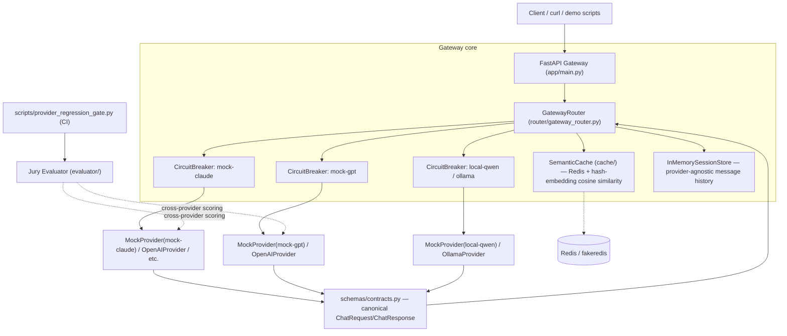
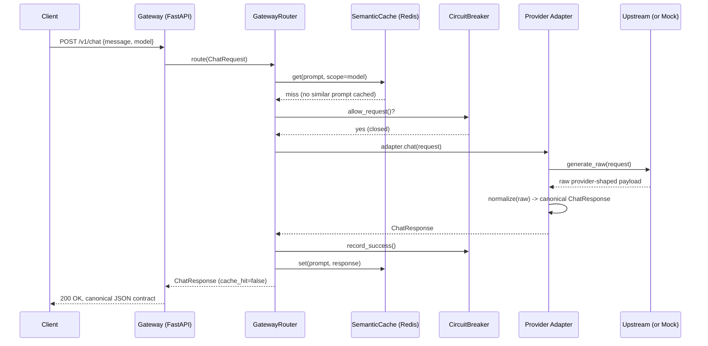
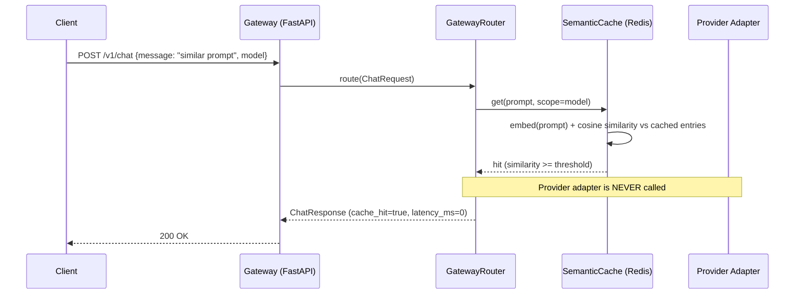
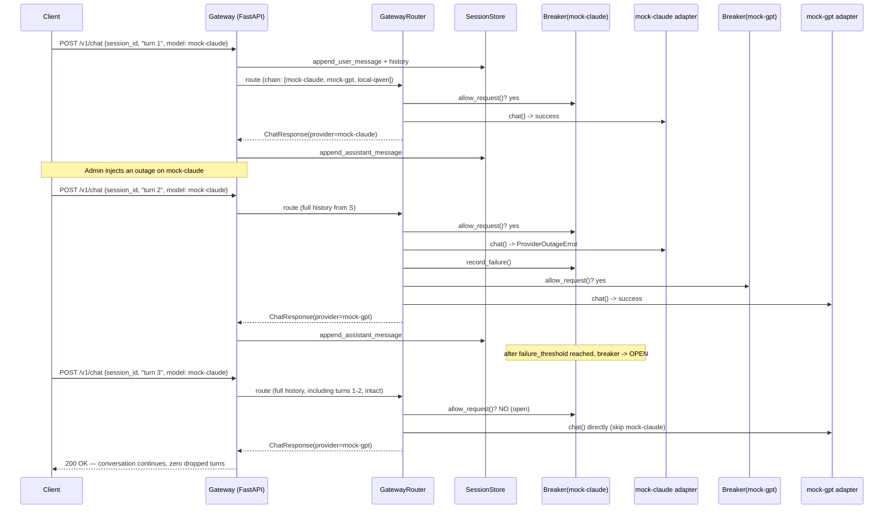

# Enterprise LLM Gateway Router

A **provider-agnostic LLM gateway** built around three ideas that matter once
you run more than one model provider in production:

1. **Schema contracts** -- every provider's response is validated/repaired
   into one canonical Pydantic contract, or rejected with a structured
   error. Callers never see provider-shaped payloads.
2. **Circuit breakers + failover** -- each provider gets its own
   closed/open/half-open circuit breaker. When a provider degrades (errors,
   429s), the router automatically fails over to the next provider in the
   chain -- **mid-conversation, with zero dropped context**.
3. **Semantic caching** -- a Redis-backed cache keyed by prompt embedding
   (cosine similarity, not exact string match) short-circuits repeat/near-
   duplicate calls before they ever reach a provider.

A fourth component, a small **LLM-jury evaluator**, cross-checks that
different providers answering the same prompt stay semantically/contractually
equivalent, and wires into an automated CI regression gate.

The entire system -- gateway, three provider "personas", cache, breaker,
router, jury -- **runs fully offline with zero API keys**, via a deterministic
`MockProvider`. Real OpenAI / GCP Vertex AI / local Ollama adapters are
included and activate automatically when credentials/Ollama are present.

> Why build the adapter layer instead of just using `litellm`? For this
> self-contained demo we wanted full control over provider-specific raw
> payload shapes (to credibly demonstrate contract repair/rejection) and a
> minimal, auditable dependency footprint. See [Architecture](#architecture)
> for the full rationale. `litellm`-style unified routing is a perfectly
> valid alternative; this repo implements the same idea with a small,
> from-scratch adapter abstraction instead.

---

## Table of contents

- [Architecture](#architecture)
- [Sequence diagrams](#sequence-diagrams)
- [Quickstart](#quickstart)
- [Demo Script](#demo-script)
- [Evaluator (LLM Jury)](#evaluator-llm-jury)
- [Deployment](#deployment)
- [Testing](#testing)
- [Configuration reference](#configuration-reference)
- [Honest limitations](#honest-limitations)
- [License](#license)

---

## Architecture



**Design decisions, honestly stated:**

* **Adapter layer, not a heavy SDK.** Each adapter (`providers/*.py`) is
  responsible for two things: (1) calling its upstream (or, for the mocks,
  deterministically synthesizing a realistic upstream-shaped payload), and
  (2) normalizing that payload into the canonical `ChatResponse` contract via
  `providers/normalize_utils.py`. Real adapters use plain `httpx` rather than
  provider SDKs to keep the dependency surface small and auditable.
* **Mock personas mimic real upstream shapes on purpose.** `mock-claude`
  produces an Anthropic-messages-shaped raw payload, `mock-gpt` an OpenAI
  chat-completions-shaped payload, and `local-qwen` an Ollama
  `/api/chat`-shaped payload. This isn't just cosmetic -- it's what lets the
  "contract normalization" and "contract enforcement" demos be genuinely
  meaningful rather than three identical mocks in a trenchcoat.
* **Semantic cache is demo-scale.** It scans all cached entries for a given
  model scope and computes cosine similarity in Python (`cache/semantic_cache.py`).
  That's O(n) per scope -- fine for a demo/small deployment, not for a cache
  with millions of entries. A production deployment should back this with a
  real vector index (RediSearch vector fields, pgvector, etc.) behind the
  same `SemanticCache` interface.
* **Embeddings are a deterministic hashing-trick fallback**
  (`cache/embedder.py`), not a real semantic embedding model. This keeps the
  whole repo network-free and dependency-light for CI/offline demos. The
  `Embedder` protocol makes swapping in `sentence-transformers` (or any real
  embedding model/API) in production a one-line change with no other code
  touched.

---

## Sequence diagrams

### (a) Normal request: cache miss → provider call → contract normalization



### (b) Cache hit short-circuit



### (c) Failover demo: primary outage → breaker opens → failover → session continuity



---

## Quickstart

```powershell
# 1. Create a virtual environment and install dependencies
python -m venv .venv
.\.venv\Scripts\Activate.ps1
pip install -r requirements-dev.txt

# 2. Run the test suite (fully offline)
pytest -v

# 3. Run the gateway directly (fakeredis fallback kicks in if no real Redis)
uvicorn app.main:app --reload --port 8000

# --- OR, with Docker Compose (Redis + gateway) ---
docker compose up -d --build
```

### Reproducing demo (a): identical request, 2+ backends, identical contract shape

```bash
curl -s -X POST http://localhost:8000/v1/chat/multi \
  -H "Content-Type: application/json" \
  -d '{"message": "What is the capital of France?", "models": ["mock-claude", "mock-gpt", "local-qwen"]}' | jq
```

or, without a running server:

```bash
python scripts/demo_multi_provider.py
```

### Reproducing demo (b): strict contract enforcement (repair + rejection)

```bash
# Repaired: inconsistent usage totals get fixed, not rejected.
curl -s -X POST http://localhost:8000/v1/contract-check \
  -H "Content-Type: application/json" \
  -d '{"provider":"mock-gpt","prompt":"demo","raw_payload":{"choices":[{"message":{"role":"assistant","content":"hi"},"finish_reason":"stop"}],"usage":{"prompt_tokens":3,"completion_tokens":2,"total_tokens":9999}}}' | jq

# Rejected: no content anywhere in the payload -> structured GatewayError.
curl -s -X POST http://localhost:8000/v1/contract-check \
  -H "Content-Type: application/json" \
  -d '{"provider":"mock-gpt","prompt":"demo","raw_payload":{"choices":[]}}' | jq
```

or: `python scripts/demo_contract_enforcement.py`

### Reproducing demo (c): fault injection, circuit breaker trip, mid-session failover

```bash
# Turn 1, served normally by the primary.
curl -s -X POST http://localhost:8000/v1/chat \
  -H "Content-Type: application/json" \
  -d '{"session_id":"demo1","message":"hello","model":"mock-claude"}' | jq '.provider'

# Inject an outage on the primary.
curl -s -X POST http://localhost:8000/admin/fault-inject \
  -H "Content-Type: application/json" -d '{"provider":"mock-claude","mode":"outage"}'

# Next calls fail over to mock-gpt once the breaker trips (default threshold: 3).
for i in 1 2 3; do
  curl -s -X POST http://localhost:8000/v1/chat \
    -H "Content-Type: application/json" \
    -d "{\"session_id\":\"demo1\",\"message\":\"turn $i\",\"model\":\"mock-claude\"}" | jq '.provider'
done

curl -s http://localhost:8000/admin/circuit-breakers | jq '.["mock-claude"]'
curl -s http://localhost:8000/v1/session/demo1 | jq '.served_by'
```

or: `python scripts/demo_failover.py` (fully offline, asserts every step).

---

## Demo Script

This maps directly to the task's three demo requirements:

| # | Requirement | How to run | What it proves |
|---|---|---|---|
| a | Identical request to 2+ backends, identical canonical shape | `python scripts/demo_multi_provider.py` or `POST /v1/chat/multi` | `providers/normalize_utils.py` coerces three *completely different* raw shapes (Anthropic/OpenAI/Ollama) into one Pydantic contract. |
| b | Malformed provider response repaired or rejected | `python scripts/demo_contract_enforcement.py` or `POST /v1/contract-check` | Inconsistent `usage.total_tokens` is silently repaired; a payload with zero content anywhere raises `SchemaContractError` -> structured `GatewayError`. |
| c | 429/outage -> breaker opens -> seamless failover, zero dropped context | `python scripts/demo_failover.py` or `admin/fault-inject` + `/v1/chat` | `router/circuit_breaker.py` trips after N failures; `GatewayRouter` fails over to the next provider in the chain; `router/session.py` keeps the full message history provider-agnostic across the switch. |

All three are also covered by automated tests: `tests/test_providers.py`,
`tests/test_failover_router.py`, `tests/test_api.py`.

---

## Evaluator (LLM Jury)

`evaluator/` implements a small **panel of independent, deterministic
judges** (`evaluator/judges.py`) that each score a pair of cross-provider
responses to the *same prompt* on a narrow signal:

* `ContractConformanceJudge` -- flags empty content, `error` finish reasons,
  inconsistent usage totals, missing provider field.
* `LengthRatioJudge` -- flags wildly mismatched response lengths.
* `KeywordOverlapJudge` -- Jaccard token overlap (lexical equivalence proxy).
* `SemanticOverlapJudge` -- cosine similarity of hash-embeddings (semantic
  equivalence proxy, reusing the same embedder as the semantic cache).

`evaluator/jury.py` aggregates votes (mean score + majority-pass rule) into a
structured `JuryVerdict` (score 0-1, pass/fail, per-judge votes, rationale,
aggregate method).

**Why a panel of small/cheap judges instead of one large LLM-as-judge call?**
Each individual judge here is intentionally narrow and deterministic (no
model call at all, in this repo's default configuration) so the panel is
fast and free to run on every CI build. The general pattern this follows --
several independent, cheap, narrow judges outvoting any single judge's blind
spot -- is a reasonable, honest middle ground between "no automated check at
all" and "one expensive LLM call per comparison", and each `BaseJudge` is a
small, swappable interface: a production deployment can replace any of these
with a real (small) model-backed judge without changing the aggregation
logic. **We deliberately do not cite specific benchmark numbers or product
comparisons for this claim** -- it's a design rationale, not a benchmarked
result.

Wired into CI via `scripts/provider_regression_gate.py`: it sends a fixed
evaluation set of prompts to two provider pairs (`mock-claude`/`mock-gpt` and
`mock-gpt`/`local-qwen`), scores each with the jury, and exits non-zero if the
mean aggregate score drops below `--threshold` (default `0.4`). This is the
kind of regression check that would catch, e.g., an adapter change that
silently truncates or corrupts responses while still producing
contract-valid JSON.

```bash
python scripts/provider_regression_gate.py --threshold 0.4
```

Try the cross-provider evaluation live:

```bash
curl -s -X POST http://localhost:8000/v1/evaluate \
  -H "Content-Type: application/json" \
  -d '{"message":"What is the capital of France?","model_a":"mock-claude","model_b":"mock-gpt"}' | jq '.verdict'
```

---

## Deployment

Deployable (not applied) infrastructure-as-code is provided for both major
clouds. **Neither has been deployed against a real cloud subscription/project
in this exercise** -- review, parameterize, and `plan`/`what-if` before any
real use. See the honesty callouts in each doc for specifics.

* **Azure** -- Azure Container Apps (gateway), Azure Cache for Redis, Azure
  API Management as the enterprise front-door, Key Vault for secrets, with
  Azure OpenAI wiring notes. Templates: [`deployment/azure/`](deployment/azure).
  Guide: [`docs/AZURE_DEPLOYMENT.md`](docs/AZURE_DEPLOYMENT.md).
* **GCP** -- Cloud Run (gateway), Memorystore for Redis, Google Cloud API
  Gateway as the front-door (documented alternative: Apigee, for orgs that
  already run it), Secret Manager, with Vertex AI wiring notes (including the
  production-recommended workload-identity approach vs. this repo's
  dependency-light static-token demo adapter). Templates:
  [`deployment/gcp/`](deployment/gcp). Guide:
  [`docs/GCP_DEPLOYMENT.md`](docs/GCP_DEPLOYMENT.md).

---

## Testing

```powershell
pip install -r requirements-dev.txt
pytest -v          # 48 tests, fully offline (MockProvider + fakeredis)
ruff check .       # lint
```

Test coverage by concern:

| File | Covers |
|---|---|
| `tests/test_schemas.py` | Contract validation + repair (Usage totals, required fields). |
| `tests/test_providers.py` | Per-persona raw-shape normalization, fault injection, repair vs. rejection. |
| `tests/test_circuit_breaker.py` | Full closed/open/half-open state machine, backoff escalation/cap. |
| `tests/test_failover_router.py` | Breaker-triggered failover, rate-limit handling, all-providers-unavailable, session continuity. |
| `tests/test_semantic_cache.py` | Hit/miss, scoping, invalidation, TTL. |
| `tests/test_jury.py` | Jury aggregation, contract-violation detection. |
| `tests/test_api.py` | End-to-end FastAPI tests for all three demo scenarios. |

No network access, API keys, or running Redis/Ollama/Docker are required to
run the full suite.

---

## Configuration reference

All configuration is environment-variable driven (see
[`.env.example`](.env.example)); every value has a working default and
**nothing is required** for the offline demo.

| Variable | Default | Purpose |
|---|---|---|
| `GATEWAY_REDIS_URL` | `redis://localhost:6379/0` | Real Redis connection string; falls back to in-memory `fakeredis` automatically if unreachable. |
| `GATEWAY_CACHE_SIMILARITY_THRESHOLD` | `0.92` | Cosine-similarity threshold for a semantic cache hit. |
| `GATEWAY_CACHE_TTL_SECONDS` | `3600` | Cache entry TTL. |
| `GATEWAY_CIRCUIT_FAILURE_THRESHOLD` | `3` | Failures within the window before a breaker opens. |
| `GATEWAY_CIRCUIT_RECOVERY_TIMEOUT_S` | `5` | Initial OPEN -> HALF_OPEN recovery delay (doubles on repeated probe failure, capped). |
| `GATEWAY_JURY_SCORE_THRESHOLD` | `0.4` | Default jury pass threshold. |
| `OPENAI_API_KEY` / `OPENAI_BASE_URL` | unset | Enables the real `OpenAIProvider`. |
| `VERTEX_PROJECT_ID` / `VERTEX_LOCATION` / `VERTEX_ACCESS_TOKEN` | unset | Enables the real `VertexAIProvider`. |
| `OLLAMA_HOST` | `http://localhost:11434` | Enables the real `OllamaProvider` if reachable. |

---

## Honest limitations

This is a demo-quality reference implementation. Specifically:

* **Mocked by default:** `mock-claude`, `mock-gpt`, and `local-qwen` are all
  `MockProvider` instances with deterministic, canned-but-realistically-shaped
  output. No real Anthropic/OpenAI/Qwen model is called unless you configure
  real credentials (`OPENAI_API_KEY`) or run a real local Ollama server
  (`OLLAMA_HOST`) with a `qwen2.5:7b`-equivalent model pulled.
* **No real Claude adapter.** "mock-claude" demonstrates Anthropic's raw
  response *shape* for contract-normalization purposes; this repo does not
  ship a real Anthropic API adapter (only OpenAI, Vertex AI, and Ollama have
  real adapters, per the stated stack).
* **Embeddings are a deterministic hashing-trick fallback**, not a trained
  semantic embedding model. Good enough to demonstrate cache hit/miss logic
  and jury semantic-overlap scoring deterministically and offline; not a
  substitute for a real embedding model in production.
* **Semantic cache scan is O(n) per model scope** -- fine at demo scale, not
  benchmarked or designed for large-scale production cache sizes (see
  [Architecture](#architecture)).
* **Session store is in-memory and single-process.** `router/session.py`
  is explicitly built behind a small interface so it could be swapped for a
  Redis/DB-backed store in a multi-instance deployment, but that swap is not
  implemented here.
* **Jury judges are deterministic, not model-backed**, by default. The
  `BaseJudge` interface supports plugging in a real small-model judge; none
  is included, to keep CI fully offline and free.
* **Deployment templates (Bicep/Terraform) are illustrative and unapplied.**
  They were written carefully (the GCP Terraform was validated with
  `terraform validate` against real provider schemas; the Azure Bicep was
  manually syntax-checked) but **neither has been deployed against a real
  cloud subscription**. Review security (network isolation, least-privilege
  IAM/RBAC, private endpoints), cost, and correctness before real use.
* **Docker Compose was validated for YAML correctness and by running the
  gateway directly via `uvicorn`** (see repo history / PR description) --
  Docker itself was not available in the development sandbox used to build
  this repo, so `docker compose up` has not been executed here. The
  Dockerfile and compose file follow standard, widely-used patterns and
  should work as-is on a machine with Docker installed; please verify in
  your own environment.

---

## License

[MIT](LICENSE)
